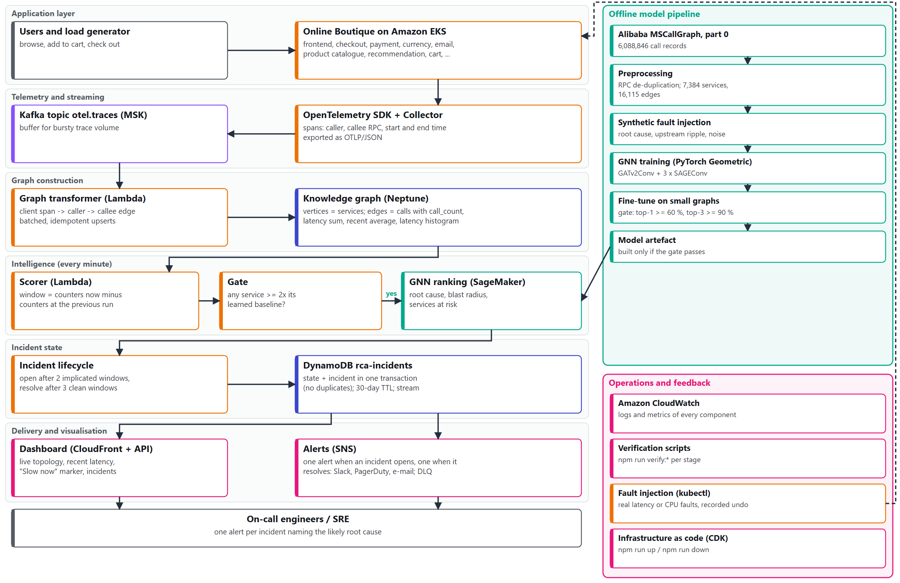
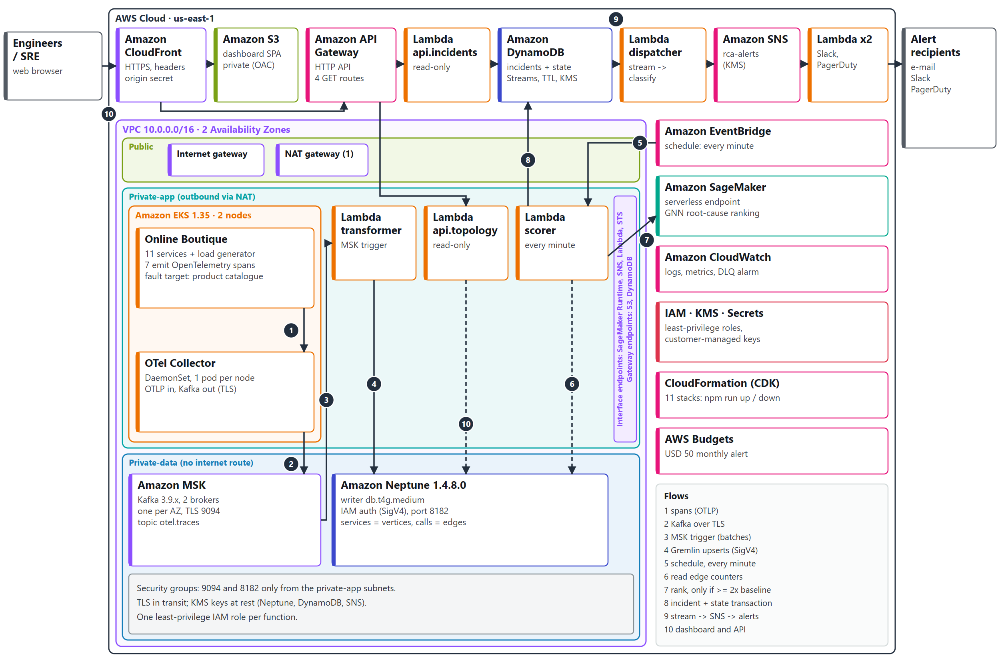
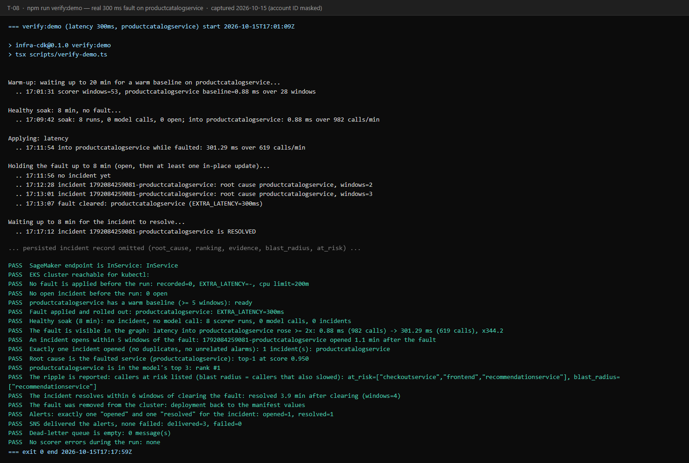
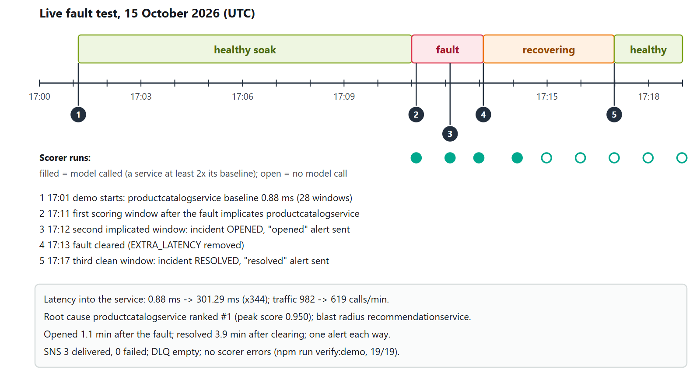
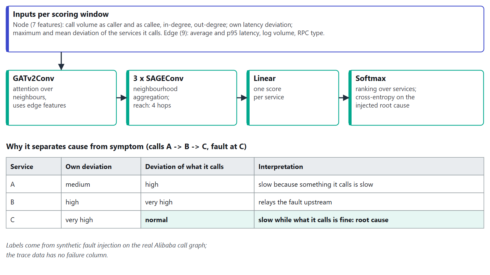
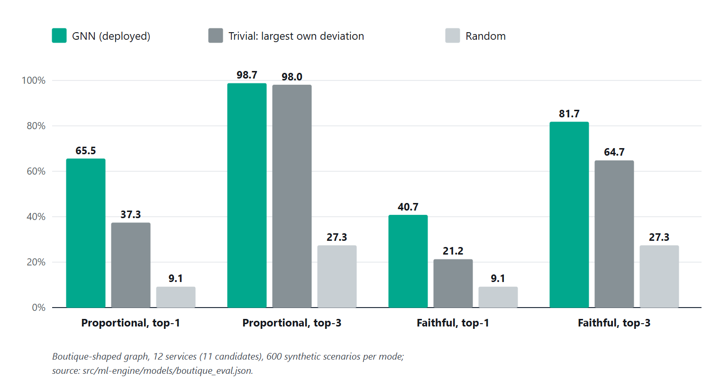

# Intelligent Microservice Dependency Analysis & RCA Framework

A cloud-native, **streaming root-cause analysis (RCA)** system for microservice platforms on AWS.
It watches live OpenTelemetry traces, keeps a continuously updated **service dependency graph**,
and uses a **Graph Neural Network (GNN)** to name the one service that most likely *caused* a
slowdown (plus its blast radius). It then raises a single incident and a single alert, instead
of one alert for every service that looks slow.

> Course project for **BCSE355L Cloud Architecture Design**, School of Computer Science and
> Engineering, VIT Vellore (2026).

**Status:** every stage is implemented and was verified on a live AWS account (2026-10-12 to
2026-10-15). The whole stack comes up with `npm run up` (about 41 minutes) and goes down with `npm run down`.

---

## Contents

1. [The problem](#1-the-problem)
2. [What the system does](#2-what-the-system-does)
3. [Architecture](#3-architecture)
4. [Validation results](#4-validation-results)
5. [Repository layout](#5-repository-layout)
6. [Prerequisites](#6-prerequisites)
7. [Run locally (no AWS)](#7-run-locally-no-aws)
8. [The model: data, training and testing](#8-the-model-data-training-and-testing)
9. [Deploy to AWS](#9-deploy-to-aws)
10. [Verify](#10-verify)
11. [Demo: inject a real fault](#11-demo-inject-a-real-fault)
12. [Destroy](#12-destroy)
13. [Integrate with your own system](#13-integrate-with-your-own-system)
14. [Configuration reference](#14-configuration-reference)
15. [Cost, limits and known caveats](#15-cost-limits-and-known-caveats)
16. [Further documentation](#16-further-documentation)

---

## 1. The problem

In a large microservice system, the service a customer notices ("checkout is slow") is rarely
the one that is broken. A slow product catalogue makes its callers slow as well, and their
callers in turn, so dashboards built per service light up for every one of them. Engineers get
too many alerts and spend their time tracing calls by hand, which keeps the mean time to recovery (MTTR) high.

This project treats the whole system as a **graph**: services are nodes and calls are weighted,
directed edges. A GNN looks at where degradation sits in that graph. A service that is slow
while everything it calls is healthy is the likely origin. A service that is slow *because*
something it calls is slow is only passing the problem on.

**What is new here, and what is not:** graph-based RCA is existing research (see the
15-paper survey in `Docs/`). This project does not propose a new GNN algorithm. Its
contribution is the **end-to-end streaming system** around one: live OTel ingestion, then a
continuously updated knowledge graph, then hosted GNN inference, then incident lifecycle and
automated alerting. Most published work evaluates on offline snapshots instead.

## 2. What the system does

1. **Captures traces.** The demo shop ([Online Boutique](https://github.com/GoogleCloudPlatform/microservices-demo)
   v0.10.7) runs on Amazon EKS and emits OpenTelemetry spans to a Collector DaemonSet.
2. **Buffers them.** The Collector exports spans as OTLP/JSON to the Kafka topic `otel.traces` on Amazon MSK.
3. **Builds the graph.** A Lambda reads Kafka, turns each CLIENT span into a `caller → callee`
   call, aggregates a batch and upserts it into **Amazon Neptune** with Gremlin. Each edge
   stores `call_count`, `latency_sum_ms`, a recent average, `last_seen_ms` and a 10-bucket
   latency histogram.
4. **Scores it every minute.** A scorer Lambda computes the change in Neptune's counters since
   its last run. It compares each service's latency with a learned per-service baseline and
   calls the **SageMaker GNN endpoint** only when some service is at least **2x** its baseline.
   This keeps a healthy system from producing alerts, since a softmax always names *some* top service.
5. **Manages incidents.** An incident **opens** after 2 consecutive implicated windows and
   **resolves** after 3 clean ones. Each incident is stored in **DynamoDB** with its root cause,
   ranking, evidence, blast radius and the services at risk.
6. **Alerts once.** A DynamoDB stream drives **SNS**, which delivers to Slack (Block Kit), PagerDuty
   (Events API v2) and e-mail. There is exactly one alert when an incident opens and one when it
   resolves. Failed deliveries go to a dead-letter queue (DLQ).
7. **Shows it.** A React + Cytoscape.js dashboard on **S3 + CloudFront** reads the live
   topology and incidents through **API Gateway** and Lambda. Services that are slow right now
   show a "Slow now" marker within seconds, before any incident opens.

## 3. Architecture



*Data flow from the application to the on-call engineer, with the offline model pipeline on the right.*



*AWS deployment: VPC 10.0.0.0/16 in us-east-1 across 2 AZs, with public, private-app and private-data subnet tiers.*

| Tier | AWS service | CDK stack |
|---|---|---|
| Network | VPC, 3 subnet tiers, NAT, VPC endpoints (SageMaker, DynamoDB, SNS, Lambda, STS, ...) | `VpcStack` |
| Compute | Amazon EKS 1.35, 2-3 x `m7i-flex.large` managed nodes | `EksStack` |
| Streaming | Amazon MSK, 2 x `kafka.t3.small`, Kafka 3.9, TLS | `MskStack` |
| Graph | Amazon Neptune `db.t4g.medium`, engine 1.4.8.0, IAM auth, KMS | `NeptuneStack` |
| Graph transform | Lambda (TypeScript, Node 22) triggered by MSK | `TransformerStack` |
| Model | SageMaker **serverless** endpoint `rca-root-cause` (PyTorch 2.6 CPU) | `SagemakerStack` |
| Incidents | DynamoDB `rca-incidents` + `rca-scorer-state`, TTL 30 days, stream | `DynamodbStack` |
| Scoring | Scorer Lambda, EventBridge `rate(1 minute)` | `ScorerStack` |
| Alerting | SNS `rca-alerts` + Slack / PagerDuty / e-mail, SQS DLQ | `AlertingStack` |
| API | API Gateway HTTP API + read-only Lambdas | `ApiStack` |
| Dashboard | S3 (private, OAC) + CloudFront | `FrontendStack` |
| Observability | CloudWatch logs and metrics for every component | (all stacks) |

All data is encrypted at rest with KMS. The private-data subnets (MSK, Neptune) have no route to the internet.

## 4. Validation results

All results below come from real runs on AWS, not simulations. The validation run injected a **real**
fault: a 300 ms `EXTRA_LATENCY` on `productcatalogservice`, which the service honours in its own
code. Everything else ran unattended.



*`npm run verify:demo` on 2026-10-15: **19 PASS / 0 FAIL / 0 WARN** (AWS account ID masked).*



| What was measured (2026-10-15 run) | Result |
|---|---|
| Healthy 8-minute soak | 0 model calls, 0 incidents (no false alarms) |
| Latency into the faulted service | 0.88 ms → 301.29 ms (x344) |
| Time to open the incident | 1.1 min after the fault |
| Root cause ranked by the GNN | `productcatalogservice` **#1**, score 0.950 |
| Blast radius / at risk | `recommendationservice` / `checkoutservice`, `frontend`, `recommendationservice` |
| Time to resolve | 3.9 min after the fault was cleared |
| Alerts | exactly 1 "opened" + 1 "resolved"; SNS 3 delivered, 0 failed; DLQ empty |

An earlier run on 2026-10-14 gave the same 19/19, with the root cause ranked #1 at 0.932.

Per-stage checkpoints passed live: `verify:eks` 4/4, `verify:msk` 5/5, `verify:transformer` 5/5,
`verify:live` 8/8, `verify:neptune` (all checks; parity with the CSVs and Neo4j),
`verify:sagemaker` 6/6, `verify:incidents` 22 PASS, `verify:alerts` 18 PASS / 2 WARN,
`verify:dashboard -- --topology` 20 PASS / 2 WARN, `verify:teardown` 13/13.

## 5. Repository layout

```
infra-cdk/                 AWS CDK app (TypeScript): 11 stacks + operational scripts
  bin/app.ts               stack wiring and context flags
  lib/*-stack.ts           one file per stack
  scripts/                 preflight, up/down, deploy-workloads, fault, verify-*, probe, pre-destroy
  test/                    Jest + CDK assertion tests for every stack and script plan
src/
  collector/               OTel Collector DaemonSet (kustomize, debug exporter)
  lambda-transformer/      all Lambda code (TypeScript, esbuild -> dist/)
    src/handler.ts         MSK -> Gremlin graph transformer
    src/scorer/            per-minute incident scorer (windows, baselines, lifecycle)
    src/alerts/            stream classifier, SNS dispatcher, Slack/PagerDuty renderers
    src/api/               dashboard API (topology + incidents)
    src/probe.ts           in-VPC Neptune diagnostics Lambda
  ml-engine/               Python: GNN training, evaluation, serving code, artifact builder
    models/                deployable weights (model_small.pt) + gate evaluation
  web-dashboard/           Vite + React 19 + Cytoscape.js dashboard
k8s/
  online-boutique/         vendored Online Boutique v0.10.7 + tracing patch
  collector-kafka/         Collector overlay exporting to MSK
  kafka-topics/            Job creating otel.traces / otel.metrics / svc.events
Dataset/                   preprocess_traces.py, load_to_neo4j.py (raw/ and processed/ are gitignored)
docker-compose.yml         local Neo4j 5, Gremlin Server 3.7.3, DynamoDB Local
Docs/                      Phase-I and final reports, literature survey, model explainer, report build pipeline
Architecture/              original architecture diagrams
prompt/                    the approved plan and as-built notes for every stage
```

## 6. Prerequisites

| Tool | Version used | Needed for |
|---|---|---|
| Node.js | 22+ (developed on 24) | CDK, Lambdas, dashboard, scripts |
| Python | 3.10+ | dataset preprocessing, GNN training, model artifact |
| Docker | any recent | local Neo4j / Gremlin Server / DynamoDB Local |
| AWS CLI | v2 | every AWS script |
| AWS CDK CLI | v2 (`npx cdk` works too) | deploy / destroy |
| kubectl | matching EKS 1.35 | workloads, faults |

Install the dependencies once:

```bash
cd infra-cdk && npm install
cd ../src/lambda-transformer && npm install
cd ../web-dashboard && npm install
cd ../ml-engine && pip install -r requirements.txt   # torch, torch-geometric, pandas, ...
```

For AWS you need a configured profile (`aws sts get-caller-identity` must succeed) on an account
on the **paid plan**. Free Tier plan accounts cannot create MSK clusters or Neptune; see [section 15](#15-cost-limits-and-known-caveats).

## 7. Run locally (no AWS)

The data and model stages, and every test suite, run without an AWS account.

```bash
# Local graph prototype (Neo4j browser at http://localhost:7474, neo4j / changeme123)
docker compose up -d neo4j
python Dataset/preprocess_traces.py      # needs Dataset/raw/MSCallGraph_0.csv, see section 8.1
python Dataset/load_to_neo4j.py          # idempotent MERGE, batched UNWIND

# Unit tests
cd infra-cdk && npm test                        # every stack + script plan
cd src/lambda-transformer && npm test           # transformer, scorer, alerts, API
cd src/web-dashboard && npm test                # dashboard (vitest)
cd src/ml-engine && python -m pytest            # features, model parity, inference, contracts

# Integration tests against real local Gremlin Server and DynamoDB Local
docker compose --profile gremlin --profile dynamodb up -d gremlin-server dynamodb-local
cd src/lambda-transformer && npm run test:integration

# Dashboard against a mock API
cd src/web-dashboard && npm run mock    # in one terminal
cd src/web-dashboard && npm run dev     # in another

# Validate all CloudFormation templates without deploying
cd infra-cdk && npx cdk synth
```

## 8. The model: data, training and testing

A plain-language walkthrough of the model is in [Docs/gnn-model-explained.md](Docs/gnn-model-explained.md).

### 8.1 Dataset

The model is trained on the **Alibaba cluster-trace-microservices-v2021** `MSCallGraph` table
([alibaba/clusterdata](https://github.com/alibaba/clusterdata/tree/master/cluster-trace-microservices-v2021)).
Only **part 0** is used: `MSCallGraph_0.tar.gz`, about 154 MB compressed and 6,088,846 rows. The
full table is about 25 GB, so do not download it all. Get part 0 with the URL pattern in that repo's `fetchData.sh`
and extract it to `Dataset/raw/MSCallGraph_0.csv`.

Facts about the raw file, verified against it directly (the dataset's docs get some of these wrong):

- It has a header row. The columns are `traceid, timestamp, rpcid, um, rpctype, dm, interface, rt`
  (`dm` comes **before** `interface`).
- `rpctype` is one of `rpc`, `db`, `mc`, `http`, `mq`, `userDefined`.
- Each `rpc` call is logged **twice**, once by the caller (positive `rt`) and once by the callee (negative `rt`).
  `preprocess_traces.py` keeps one row per `(traceid, rpcid)` using `abs(rt)`. Other types are not deduplicated.
- Service names are anonymised hashes. Missing values (`NAN`, `(?)`, empty) are filtered, and the counts are logged.
- **There is no error or failure column.** All fault labels come from synthetic injection (8.2).

Output: `Dataset/processed/nodes.csv` and `edges.csv`, which hold **7,384 services and 16,115 call edges**.

### 8.2 Labels by synthetic fault injection

`src/ml-engine/fault_injection.py` creates labelled scenarios on the real topology:

1. It picks a root-cause service that has at least one caller.
2. It spreads the slowdown **upstream** through the callers, up to 4 hops, weighted by how much of each
   caller's traffic depends on the faulty path.
3. It adds 2-6 unrelated **distractor spikes** and background jitter on every node. Without them
   the task is trivially easy: about 97% accuracy with no noise, falling to 39% once realistic noise was added.

The key signal is a mismatch. The root cause has a **high own deviation while the services it calls
look normal**. Services that only relay the problem have both values high.

### 8.3 Architecture

```
GATv2Conv (uses edge features) -> SAGEConv -> SAGEConv -> SAGEConv -> Linear -> one score per node
```

- Node features: scaled call volumes and in/out degree, plus 3 dynamic values (own deviation and
  max/mean deviation of the services it calls).
- Edge features: average and p95 latency, log call volume and a one-hot `rpctype`.
- The output is a softmax over nodes. The top node is the root cause, and the ranked list gives the blast radius.



### 8.4 Training

```bash
cd src/ml-engine

# Stage 3: train on the full 7,384-node Alibaba graph (3,000 scenarios, 70/15/15 split, 60 epochs)
python train.py                      # -> artifacts/model.pt
python train.py --features own       # ablation: own deviation only
python train.py --arch plain         # control: original architecture
python predict.py                    # interactive: break a service, see the model's top 10

# Stage 10: fine-tune for small graphs like Online Boutique (12 services)
python train_small.py                # starts from artifacts/model.pt -> artifacts/model_small.pt
python train_small.py --scratch      # random init instead of fine-tuning
```

`artifacts/` is gitignored. The weights that are actually deployed are committed in `models/model_small.pt`.

**Why fine-tune?** Features are min-max scaled per graph, so a 12-node graph looks nothing like the
7,384-node training graph. The Stage 3 weights scored only 52.8% top-1 on a Boutique-shaped graph.
`train_small.py` trains on random layered topologies of 8-30 services and on ego-subgraphs cut from
the Alibaba graph. The Boutique topology itself is **held out**, so the evaluation measures
generalisation rather than memorisation.

### 8.5 Results

| Graph | Metric | GNN | Trivial (largest own deviation) | Random |
|---|---|---|---|---|
| Alibaba, 7,310 candidates (Stage 3 weights) | top-1 / top-3 / top-5 | **62.9% / 91.8% / 98.2%** | 22.2% / 65.3% / 91.8% | 0.014% |
| Boutique-shaped, 11 candidates (deployed weights) | top-1 / top-3 | **65.5% / 98.7%** | 37.3% / 98.0% | 9.1% / 27.3% |



Fine-tuning costs some accuracy on the original Alibaba test (top-1 62.9% → 52.0%). All labels are
synthetic. The Boutique volumes and latencies in `fixtures/boutique_topology.json` are seeded
placeholders, while the topology is derived from the Kubernetes manifest.

### 8.6 Testing and packaging the model

```bash
cd src/ml-engine
python -m pytest                                     # all model tests
python evaluate_boutique.py --weights models/model_small.pt   # deployment gate: exit 0 if top-1 >= 60% and top-3 >= 90%
python derive_boutique_topology.py --check           # fixture still matches the manifest
python score_local.py --in snapshot.json             # score a request exactly as the endpoint would
python build_artifact.py                             # -> dist/model.tar.gz (refuses weights without a passing evaluation)
```

The test suite covers these checks:

- **Model parity:** `model_pure.py` re-implements GATv2Conv/SAGEConv in plain PyTorch so the
  serving container does not need torch_geometric. Its output matches PyG exactly (max difference 0).
- **Golden features:** `features.py` (serving) matches `graph_dataset.py` (training) on the real CSVs.
- **Contract:** `tests/test_scorer_contract.py` and the Jest fixture
  `src/lambda-transformer/test/fixtures/scorer-request.json` pin the request format from both sides.
- **Endpoint parity (live):** `npm run verify:sagemaker` checks the deployed endpoint against
  `score_local.py`. The measured difference was 9.9e-10.

## 9. Deploy to AWS

> **Cost guardrail:** MSK, Neptune and EKS bill by the hour even when idle. The full stack costs about
> **USD 0.60/hour**. `npm run preflight` refuses to continue unless an **AWS budget alert** exists.
> Tear everything down when you finish (section 12).

### 9.1 One-time setup

```bash
cd infra-cdk
cp .env.example .env          # set RCA_ALERT_EMAIL=you@example.com (comma-separated list allowed)
npm run preflight             # credentials, tools, budget alert, region
npm run bootstrap             # CDK bootstrap, once per account/region
```

### 9.2 Everything in one command (recommended)

```bash
npm run up                    # about 41 min measured; MSK is the slowest part
```

`up` does the following:

1. Runs preflight and checks that no stack is mid-update or failed.
2. Builds once: the Lambda bundles, the model artifact and the dashboard.
3. Runs **one** `cdk deploy` of all 11 stacks with `--concurrency 10`.
4. Deploys the Kubernetes workloads: Online Boutique, the Kafka topics and the Collector.

Options: `--dry-run` (checks and synth only), `--no-email`, `--email=a@x.com,b@y.com`,
`--no-dashboard` (skips ApiStack and FrontendStack). Each alert recipient must confirm the SNS subscription e-mail.

The dashboard URL is the `DashboardUrl` output of `FrontendStack`:

```bash
aws cloudformation describe-stacks --stack-name FrontendStack \
  --query "Stacks[0].Outputs[?OutputKey=='DashboardUrl'].OutputValue" --output text
```

The Boutique storefront stays private. Reach it with:

```bash
kubectl port-forward svc/frontend-external 8080:80     # then open http://localhost:8080
```

### 9.3 Stage by stage (for debugging)

Every stack has its own `deploy:*`, `verify:*` and `destroy:*` script. Deploy in dependency order:

```bash
npm run deploy:vpc
npm run deploy:eks && npm run deploy:msk
npm run deploy:workloads                         # uses the Kafka collector when MskStack exists
npm run deploy:neptune
npx cdk deploy TransformerStack -c graphBackend=neptune
npm run deploy:sagemaker                         # builds and gates the model artifact first
npm run deploy:dynamodb
npm run deploy:scorer
npm run deploy:alerts -- -c alertEmail=you@example.com   # repeat the flag on every redeploy, or the subscription is removed
npm run deploy:api -- -c topology=neptune
npm run deploy:frontend -- -c topology=neptune
```

### 9.4 Slack and PagerDuty (optional)

The notifier Lambdas read two SSM SecureString parameters. If a parameter is not set, that
channel logs the rendered payload instead of sending it, so the chain can be verified without third-party accounts.

```bash
aws ssm put-parameter --name /rca/alerts/slack-webhook-url   --type SecureString --value "https://hooks.slack.com/services/..."
aws ssm put-parameter --name /rca/alerts/pagerduty-routing-key --type SecureString --value "<routing key>"
```

## 10. Verify

Each verifier is read-only (or cleans up after itself) and prints PASS/WARN/FAIL per check. Run them from `infra-cdk/`:

| Command | Proves |
|---|---|
| `npm run verify:vpc` | VPC, 6 subnets in 3 tiers, no internet route from private-data, endpoints available |
| `npm run verify:eks` | nodes Ready across AZs, Boutique pods Running, Collector receiving spans |
| `npm run verify:msk` | cluster ACTIVE, topics exist, spans arrive on `otel.traces` |
| `npm run verify:transformer` | Lambda trigger enabled, batches processed, no errors |
| `npm run verify:neptune` | signed access, concurrent upserts exact, parity with the CSVs and Neo4j (`-- --full`, `--skip-neo4j`) |
| `npm run verify:live` | live Boutique edges in Neptune, counters growing |
| `npm run verify:sagemaker` | endpoint InService, parity with local scoring, injected fault ranked #1 |
| `npm run verify:dynamodb` | tables, GSIs, TTL, encryption, conditional writes |
| `npm run verify:incidents` | healthy soak stays quiet; a synthetic slow-down opens, updates and resolves one incident |
| `npm run verify:alerts` | one alert on open, none on in-place updates, one on resolve; SNS delivered, DLQ empty |
| `npm run verify:dashboard -- --topology` | HTTPS site, security headers, API through CloudFront, origin guard, live topology |
| `npm run verify:demo` | the full end-to-end fault demo (section 11) |
| `npm run verify:teardown` | after `down`: nothing billable is left |

Diagnostics: `npm run probe -- status|stats|edges|wsdiag` runs queries against Neptune from inside the VPC.

## 11. Demo: inject a real fault

Automated demo, about 30 minutes: warm-up, then an 8-minute healthy soak, then the fault, the incident, clearing it and resolution.

```bash
npm run verify:demo                                   # 300 ms latency on productcatalogservice
npm run verify:demo -- --fault=latency --delay=100ms
# timings in minutes: --warm=20 --soak=8 --hold=8 --recover=8
```

Manual demo (keep the dashboard open while you do this):

```bash
npm run fault -- latency --delay=300ms                # productcatalogservice sleeps in every RPC
npm run fault -- status
# within about 1-2 minutes: "Slow now" on the dashboard -> incident OPEN -> alert e-mail/Slack/PagerDuty
npm run fault -- clear                                # restores the exact previous values
# about 4 minutes later: incident RESOLVED -> second alert
```

The previous values are saved in `infra-cdk/.fault-state.json` before a fault is applied, so `clear` is always exact.
A CPU fault (`npm run fault -- cpu --service=currencyservice --limit=15m`) is also available,
but at 15m the starved pod fails its readiness probe and never serves traffic, so there is nothing to detect.

## 12. Destroy

```bash
npm run down               # asks you to type "destroy"; --yes skips the prompt
npm run verify:teardown    # 13 checks; only the CDKToolkit stack may remain
```

`down` does the following:

1. Clears any recorded fault.
2. Removes Kubernetes-created load balancers and checks that none are left in the VPC.
3. Runs **one** `cdk destroy` with the same context flags as `up`. The cross-stack references
   are weak, so those flags are what keep the deletion order safe.
4. Runs the teardown sweep.

It is safe to re-run. To tear down stage by stage, use the reverse of the deploy order and run
`npx tsx scripts/pre-destroy.ts` before destroying EKS or the VPC. If a first deploy fails, the stack is left
in `ROLLBACK_COMPLETE` and must be destroyed before you redeploy it.

## 13. Integrate with your own system

The pipeline is decoupled at four points. You can adopt as much of it as you need.

### 13.1 Send your own traces

Any service instrumented with OpenTelemetry can feed the graph. Point its OTLP exporter at the Collector:

```
OTEL_EXPORTER_OTLP_ENDPOINT=http://otel-collector.observability.svc.cluster.local:4317   # gRPC (4318 = HTTP)
```

For Online Boutique this is done with `ENABLE_TRACING=1` and `COLLECTOR_SERVICE_ADDR` (see
`k8s/online-boutique/kustomization.yaml`). If you are not on EKS, any Collector that exports to
MSK with `encoding: otlp_json` and `topic: otel.traces` works. Use
`k8s/collector-kafka/otel-collector-config.yaml` as the template.

Edges are built **only from CLIENT spans** (`src/lambda-transformer/src/edges.ts`):

- **Caller:** the span's `service.name`.
- **Callee:** the first of `peer.service`, `server.address`, `net.peer.name`, `net.sock.peer.name`
  or the URL host, normalised (port, scheme and `*.svc.cluster.local` stripped, bare IPs rejected).
  If none of these gives a name, the gRPC service from `rpc.service` / `rpc.method` is used, lower-cased.
- Health-check, reflection and OTel-exporter RPCs are ignored.

The most reliable integration is to set **`peer.service`** on your client spans. The gRPC fallback
works because Boutique's deployment names equal its lower-cased gRPC service names. Check your naming before relying on it.

### 13.2 Read the graph

Neptune holds `service` vertices and `calls` edges with cumulative counters (`call_count`,
`latency_sum_ms`, `h0..h9`, `last_seen_ms`). Average latency is `latency_sum_ms / call_count`.
Query it with Gremlin from inside the VPC (IAM/SigV4 auth). Alternatively, use the dashboard API,
which also returns recent-window figures:

```
GET /api/topology            nodes + edges, recent latency, "degraded" flags, open incidents
GET /api/health              liveness
GET /api/incidents           recent incidents (?status=OPEN|RESOLVED, ?service=...)
GET /api/incidents/{id}      one incident with ranking, evidence, blast radius
```

The API is served same-origin through CloudFront. Direct execute-api calls need the CloudFront
origin header and return 403 without it. This guard is demo-grade, not user authentication.
Add Cognito or IAM auth before exposing it to real users.

### 13.3 Call the model directly

The SageMaker endpoint `rca-root-cause` accepts any small service graph:

```json
{
  "nodes": [{"name": "checkout", "total_calls_as_um": 1200, "total_calls_as_dm": 300, "own_delta": 0.1}],
  "edges": [{"um": "checkout", "dm": "payment", "avg_latency_ms": 2.1, "p95_latency_ms": 5.0,
             "call_count": 1200, "rpctype": "rpc"}],
  "top_k": 3
}
```

`own_delta` = observed latency / normal latency - 1 for each service. The response ranks the
services by root-cause score. Try it offline with `python src/ml-engine/score_local.py --in request.json`.
Retrain on your own topology with `train_small.py --include-boutique`, or adapt `derive_boutique_topology.py` to your manifest.

### 13.4 Consume incidents and alerts

- **SNS topic `rca-alerts`:** subscribe any endpoint (HTTPS webhook, SQS, Lambda, e-mail). The
  message is the versioned alert event in `src/lambda-transformer/test/fixtures/alert-event.json`
  (the rendered Slack/PagerDuty payloads are in `alert-payloads.json` next to it).
- **DynamoDB `rca-incidents`:** query the `by-status` or `by-service` GSIs, or attach your own
  consumer to the table stream. TTL deletion is lazy, so filter on `expires_at`.
- **PagerDuty** uses `dedup_key = incident_id`, so repeated deliveries are idempotent.

### 13.5 Tuning

Every scorer threshold is in `src/lambda-transformer/src/scorer/config.ts`:

- 2x gate
- 20-call minimum for baseline learning
- 5 warm-up windows
- 2 windows to open, 3 to resolve
- 1 ms latency floor
- EWMA rate

## 14. Configuration reference

| Setting | Where | Default |
|---|---|---|
| `RCA_ALERT_EMAIL` | `infra-cdk/.env` | required by `up` unless `--no-email` |
| `-c graphBackend=log\|neptune` | CDK context, TransformerStack | `log` (`up` passes `neptune`) |
| `-c topology=none\|neptune` | CDK context, ApiStack | `none` (`up` passes `neptune`) |
| `-c alertEmail=a@x,b@y` | CDK context, AlertingStack | none |
| `-c neptuneReplica=true` | CDK context, NeptuneStack | writer only |
| `-c dashboardUrl=...` | CDK context, links in alerts | none |
| `BUDGET_CONFIRMED=1` | env, preflight | confirm the budget manually if it cannot be queried |
| `/rca/alerts/slack-webhook-url`, `/rca/alerts/pagerduty-routing-key` | SSM SecureString | unset = log only |
| `NEO4J_URI` / `NEO4J_USER` / `NEO4J_PASSWORD` | env, `load_to_neo4j.py` | `bolt://localhost:7687`, `neo4j`, `changeme123` |

The region is **us-east-1**.

## 15. Cost, limits and known caveats

- **Cost:** about USD 0.60/hour for the full stack. The SageMaker endpoint is serverless and has no
  idle cost. All usage from 1-15 October 2026 came to USD 8.51 before credits.
- **Account plan:** Free Tier plan accounts cannot create MSK or Neptune and cannot launch
  `t3.large` (so the EKS nodes use `m7i-flex.large`). A new account may also need AWS Support to
  enable CloudFront. Network Load Balancers were still refused on the test account, while ALB and
  Classic ELB worked. That is why the storefront is reached by port-forward.
- **Span coverage:** only 7 of Boutique's 11 services emit spans (frontend, checkout, currency,
  email, payment, productcatalog, recommendation). The others appear only as callees.
- **Detection floor:** real edge latencies are 0.3-2.3 ms, and the 1 ms floor makes the 2x gate
  insensitive to changes below about 2 ms. Low-traffic services (checkout, payment, email) rarely
  reach 20 calls/min, so they may never get a baseline.
- **Not yet proven live:** real Slack/PagerDuty HTTP delivery and SSM SecureString decryption.
  Both are covered by unit tests against a local server. Set the two SSM parameters and run
  `verify:alerts` to prove them.
- **Model:** labels are synthetic. The live test covered single-service latency faults, not complex real cascades.

## 16. Further documentation

| Document | Content |
|---|---|
| [Docs/AWS_Cloud_Project_Report_Final.pdf](Docs/AWS_Cloud_Project_Report_Final.pdf) | final project report |
| [Docs/gnn-model-explained.md](Docs/gnn-model-explained.md) | how the model finds the root cause |
| [prompt/](prompt/) | approved plan and as-built notes for every stage, including every defect found live and its fix |
| [Docs/report-build/claims.md](Docs/report-build/claims.md) | the source of every number in the report |
| [CLAUDE.md](CLAUDE.md) | full engineering context and stage history |
